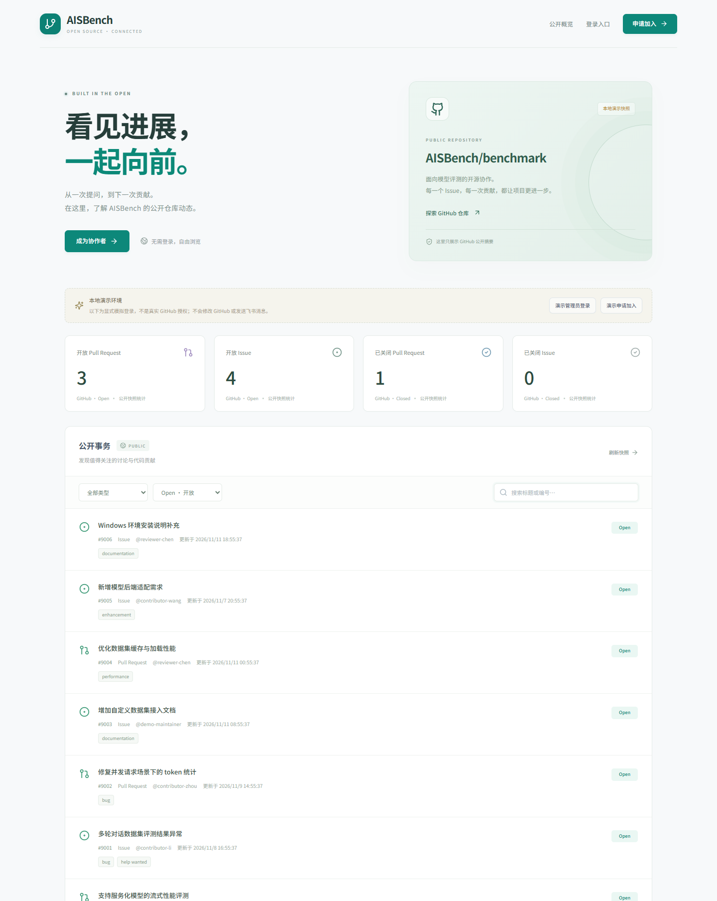

# AISBench Triage · v0.3

面向 [AISBench/benchmark](https://github.com/AISBench/benchmark) 的 PR / Issue 团队管理平台：**游客公开概览 → GitHub 验证并显式申请 → 管理员审核白名单 → 重新登录成员工作区 → 本人绑定飞书与事务闭环**。

> 单团队、单仓库、单实例。开放申请，不自动授予成员权限；不保存账号密码。GitHub 集成只读，负责人、进度、优先级、截止时间属于平台内部字段，不向游客公开，也不会自动合并 PR、关闭 Issue 或发表评论。



[查看成员工作台预览](docs/preview.png)

## 快速体验

需要 Node.js **24+** 与 npm：

```bash
npm ci
npm run build
npm run demo
```

打开 **http://127.0.0.1:3210**，首次匿名进入游客概览，不会创建成员会话，也没有个人中心。演示使用独立 `data/demo.sqlite`，不访问 GitHub / 飞书、不发送真实消息，任务和账号都是模拟数据。

- 点击“演示申请加入”：模拟已完成 GitHub 身份验证，填写说明并明确同意用途后提交；身份验证本身不创建申请或成员。
- 用另一个浏览器会话点击“演示管理员登录”，进入“加入申请”审核。
- 申请者刷新本人状态，审核通过后仍是受限会话；点击“重新演示成员登录”才进入 `/workspace`。不能借旧申请 Cookie 自动升级。
- 演示管理员可继续在成员管理中核验模拟账号 `new-contributor`，体验预录入、角色、启停及版本冲突。

演示中的审核和角色修改持久保存，不会因重启自动重置。模拟申请者已有历史申请时会显示原状态；不要通过清空真实数据来重置演示。真实成员 CLI 禁止在演示模式使用。

## v0.3 注册审核与游客边界

- `/` 永远是公开门户，即使已登录成员也先看公开页面，可点击进入成员工作区。
- 游客只看独立快照中的 GitHub 公开统计和摘要；没有正文、内部负责人、工作流、截止时间、成员列表、通知或个人中心。
- 真实 GitHub OAuth 后，未知身份获得 30 分钟受限申请会话，仅可提交和查询自己的申请；成员会话独立。
- 申请须明确确认资料用途、填写 10–2000 字说明；同一固定身份最多一条待审核申请。管理员通过 / 拒绝逐条确认并检查 version，默认授予普通成员资格。
- 公开反馈与管理员内部备注分开；拒绝后默认冷却 24 小时才可新申请。已有成员无需重新审核，已停用成员不能重申请绕过停用。
- 保留管理员预录入：遇到同一待审核申请，需要明确确认并在同一事务中同步批准，不产生重复成员。
- “访问策略”分别控制注册与公开概览。注册默认接受申请，正式环境公开数据默认关闭；这与全局飞书提醒开关是三套不同策略。
- 公开概览开启前核验目标仓库 public / 固定仓库 ID。完整同步前后分别核验，后置校验不能复用数据抓取完成前已开始的请求。私有化 / 核验失败撤销投影；公开性超过 60 秒未刷新则游客接口失败关闭，不回退内部数据。
- 游客 GET 不触发 GitHub 同步。后台按 15 秒 worker 节奏检查，公开性缓存有效时不重复请求；实际更新仍受网络和配额影响。公开接口 no-store，不部署长缓存 CDN。

正式启用步骤：**管理员登录 → 访问策略 → 启用公开仓库概览 → 手动同步 GitHub → 新匿名窗口验收**。重新启用后无快照属于正常状态，不能用内部快照补位。建议配置具备所需只读权限的 GitHub 凭证，匿名 API 配额难以承受同步与公开性定期核验。

## 已实现的成员工作区功能

- 仓库工作台、关键词 / 类型 / GitHub 状态 / 工作流 / 负责人 / 模块筛选。
- 基于固定 GitHub 用户 ID 的准入与个人待办，用户名改名不丢权限，旧用户名被别人占用不会继承权限。
- 管理员核验真实 GitHub 个人账号并确认后预录入成员；支持姓名、模块、备注、角色、状态筛选与分页。
- 成员首次登录激活；停用会撤销会话、OAuth 待办、待发通知，并使飞书关联重新待确认；不删除历史分派。
- 最后一名已激活正常管理员保护、成员资料与事务的版本冲突校验。
- 分派给尚未登录的成员、管理员批量原子分派、普通成员显式认领未分派事务（不可抢占）。
- GitHub 状态与平台进度分开；关闭后不催办，GitHub 重新打开且本地已完成时标记需复核。
- 个人飞书 OAuth 绑定 / 解绑、测试确认、通知开关与 Asia/Shanghai 跨午夜免打扰。
- 已签名 Webhook 持久化、快速 202 应答、去重、批次新快照、重试；默认 10 分钟轮询兜底，15 秒后台检查事件与通知队列。
- 本地分派事件通知、GitHub 事件通知、超期催办、管理员兜底、不可达原因与通知记录。
- 发送前重新检查成员、事务、绑定版本和全局规则；解绑 / 重绑具有持久化代次，旧授权或测试不能复活新绑定。
- 操作审计、运行状态、事件积压 / 通知统计、GitHub 限流退避和定期数据保留清理。
- 版本化 SQLite 迁移、旧白名单一次性核验导入、受控管理员初始化 / 恢复、一致性在线备份 CLI。

## 正式运行

### 1. 配置环境

复制 [.env.example](.env.example) 为本地 `.env`，填写服务器端凭证，不要提交真实 `.env` 或数据库。

```dotenv
DEMO_MODE=false
BASE_URL=https://triage.example.com
HOST=127.0.0.1
PORT=3210
GITHUB_REPO=AISBench/benchmark
GITHUB_CLIENT_ID=...
GITHUB_CLIENT_SECRET=...
GITHUB_TOKEN=...
GITHUB_WEBHOOK_SECRET=...
FEISHU_APP_ID=...
FEISHU_APP_SECRET=...
SYNC_INTERVAL_MINUTES=10
```

`BASE_URL` 必须是用户实际访问的源，不能带路径、查询参数或账号密码。正式 `NODE_ENV=production` 强制 HTTPS，并禁止演示模式。应用默认不信任转发头；位于反向代理之后时按实际代理地址配置 `TRUST_PROXY`，不要使用 `true` 或不受控跳数。

### 2. 初始化首位管理员

新数据库使用一次性本地 CLI，服务端查询真实 GitHub 个人身份并写入固定 ID：

```bash
npm run bootstrap -- --github Libotry
npm run build
npm start
```

管理员首次使用 GitHub OAuth 登录激活原记录，随后通过网页预录入其他成员。初始化成功后重复 bootstrap 会被拒绝，不会在重启时覆盖数据库角色。

**运行时不再根据 `ADMIN_GITHUB_LOGINS` / `ALLOWED_GITHUB_LOGINS` 授权。** 这两个变量只作为 v0.1 旧系统迁移输入。成员名单、角色与状态都以数据库为准，不需要为日常增减成员重启服务。

若尚未初始化，服务可以启动并接受受限的加入申请，但陌生账号不会获得成员权限，也没有人能通过网页自动成为管理员。必须先完成本地首管理员引导，才能审核申请。审核通过者仍须重新 GitHub 登录。

### 3. GitHub 应用与仓库读取

创建 GitHub OAuth App：Homepage 为 `BASE_URL`，回调为 `BASE_URL/auth/github/callback`。登录只申请 `read:user`，身份 Token 不保存、不作为仓库操作凭证。

仓库读取使用服务器独立凭证。公开仓库可匿名读取，但完整 PR / CI 同步容易耗尽匿名配额；应按目标仓库和组织策略配置适用的只读 PAT 或后续 GitHub App 方案。只申请读取 Metadata / Issues / Pull requests / Checks / Commit statuses 所需权限，不给平台自动写入权限。

平台成员权限不等于 GitHub collaborator / organization 权限。私有仓库的内容共享范围须由管理员单独确认。部署拉取本平台私有源码的 deploy key 与业务仓库读取 Token 也应分开。

### 4. GitHub Webhook

需目标仓库管理员配置：

- Payload URL：`BASE_URL/api/webhooks/github`
- Content type：`application/json`
- Secret：与服务器 `GITHUB_WEBHOOK_SECRET` 相同的长随机值。
- 订阅 Issues、Issue comments、Pull requests、Pull request reviews、Pull request review comments。

接收端先验签、按 delivery ID 入库去重，返回 202；后台每 15 秒处理待办，同批最多 50 个事件共享一个接收后的新快照，避免使用事件之前已开始的同步。失败退避重试；GitHub 配额不足时保存快照并显示退避状态。

没有仓库管理权限时，可先使用轮询和本地分派 / 超期催办，但不能宣称有完整的即时事件通知，也不会通过轮询重建所有评论历史。

### 5. 飞书企业自建应用

启用机器人能力、申请应用身份个人消息权限（例如 `im:message:send_as_bot`，以实际控制台为准），发布版本并将实际用户纳入可用范围。OAuth 回调为 `BASE_URL/auth/feishu/callback`。

成员先 GitHub 登录，再由本人授权飞书。绑定只获取该应用作用域内的真实 open_id，不支持手填他人身份，不保存长期用户 Token，不向前端或管理员接口返回完整 open_id。

**OAuth 关联后仍须本人发送测试消息**，只有当前绑定测试成功才启用发送资格。解绑、重绑、成员停用、迁移或更换 App ID 都不能复用旧验证结果。正常停用再启用后仍需本人测试确认。

### 6. 开启提醒

全局规则默认关闭。成员真实收信测试通过后，由管理员开启提醒；GitHub 事件和本地分派均遵守此开关。

- 静默阈值默认 48 小时；设置明确截止时间时，优先按截止时间判断超期。
- 超期冷却默认 24 小时，从成功发送时间计算。
- 待激活、未绑定、待确认、通知关闭等情况记录为不可达 / 已跳过，不伪装成已发送。
- 免打扰延期但不累计失败次数；同类催办 pending / sending 时不重复堆积。
- 暂时发送失败按退避最多重试 3 次，复用 UUID；明确权限错误终止重试。
- 发送期间恰好撤销权限时，不能召回上游已接受的消息；实际已投递边界写审计，不恢复被取消队列。

## 从 v0.2 升级到 v0.3

先做一致性备份，再停止旧实例、更新代码并构建。新版本启动执行 schema3 的增量迁移，保留现有成员、角色、停用状态、绑定与事务，无需重新初始化管理员，也不需要再次导入旧环境白名单。

```bash
npm run backup -- --output backups/pre-v03.sqlite
npm ci
npm test
npm run build
npm start
```

新增注册身份、受限会话、申请和公开投影表。`pending_activation` 仍表示已批准但未首次激活的成员，不能与注册申请 `pending` 混用。线上公开开关迁移后默认关闭，由管理员核验并开启。旧版个人链接请改用 `/workspace?item=...`，根路径现为公开门户。

升级失败时使用备份和匹配旧镜像回退，旧代码不应写入 schema3 数据库。不要同时运行两个版本访问同一数据卷。

## 从 v0.1 升级

**先备份，再迁移；不要用新建管理员命令代替旧成员迁移。**

```bash
npm run backup -- --output backups/pre-v02.sqlite
# 在 .env 中临时保留原 ADMIN_GITHUB_LOGINS、ALLOWED_GITHUB_LOGINS
npm run migrate:members
npm test
npm run build
npm start
```

迁移先在事务外核验全部 GitHub 身份，再原子写入；保留用户偏好、事务、历史通知和分派。无法确认的 owner 标记待核对，旧待发消息取消，旧会话撤销，飞书绑定转为待测试确认。

用户名复用、身份冲突、查询失败、模拟数据或无可用管理员时，迁移失败关闭，不放宽访问。初始化完成后重跑不覆盖网页角色。建议先在备份副本演练，并查阅 [设计中的迁移方案](docs/DESIGN.md#15-现有初版迁移方案)。

## 管理员恢复与备份

```bash
# 仅在拥有服务器本地权限、确需恢复管理权时执行；记录审计，不提供网页后门。
npm run recover:admin -- --github YOUR_VERIFIED_GITHUB_LOGIN

# SQLite 在线一致性备份，包含已提交 WAL 内容；目标必须是不存在的新文件。
npm run backup -- --output backups/platform-20261111.sqlite
```

备份属于敏感资料，应加密、放一份到服务器之外并定期恢复演练。不能只复制运行中的 SQLite 主文件。迁移回滚应同时匹配数据库版本与应用镜像版本，恢复验证期间先关闭提醒，避免误补发。

## 部署与运维

已有应用 [Dockerfile](Dockerfile) 与 [Compose 配置](compose.yaml)；容器非 root 运行，宿主仅发布 `127.0.0.1:3210`，数据库在命名数据卷中。只运行**一个实例**。

```bash
docker compose build
docker compose run --rm platform node server/cli.js bootstrap --github Libotry
docker compose up -d
```

前置 HTTPS 请使用宿主机 Caddy / 现有 Nginx，样例见 [Caddy 配置](deploy/Caddyfile.example)。容器化代理不能使用它自己的 127.0.0.1 访问另一个容器。服务器部署清单与恢复步骤见 [运维说明](docs/OPERATIONS.md)。

默认已完成事件载荷保留 30 天，终态通知 / 审计保留 180 天，可通过环境配置调整；未处理 / 待重试任务不会按该策略删除。运行状态页面展示集成配置、最近同步、配额退避、成员和队列数量，不把健康检查成功当成真实集成成功。

## 开发与测试

```bash
npm test
npm run build
npm run test:browser  # 需要本机 Google Chrome，使用独立随机演示数据库和3211端口
npm run dev
npm run dev:client
```

自动测试不发送真实飞书消息，GitHub / 飞书使用 mock；本地 HTTP、SQLite 和 Chrome 浏览器是真实运行。Vite 仅开发使用，生产由 Express 同源提供构建产物。

- [注册审核与游客设计](docs/REGISTRATION-GUEST-DESIGN.md)
- [原平台设计](docs/DESIGN.md)
- [接口契约](CONTRACT.md)
- [v0.3 验证记录](docs/VALIDATION-V03.md)
- [v0.2 历史验证记录](docs/VALIDATION-V02.md)
- [v0.1 历史验证记录](docs/VALIDATION.md)

## 仍需目标环境验收的边界

真实 GitHub OAuth、目标仓库 Webhook、飞书租户授权及个人收信，需要部署者提供应用与环境配置后实测；本次代码补齐不等于已经部署海外服务器。Docker 构建、实际 HTTPS 与异地备份恢复也必须在目标环境验证。

首轮不含多仓库、多租户、GitHub 写操作、CI 失败即时消息、GitHub Team reviewer 展开和飞书交互卡片。全量同步在仓库较大时仍有耗时与 API 配额成本；不承诺消息严格 exactly-once，也不承诺所有事件 15 秒内送达。
